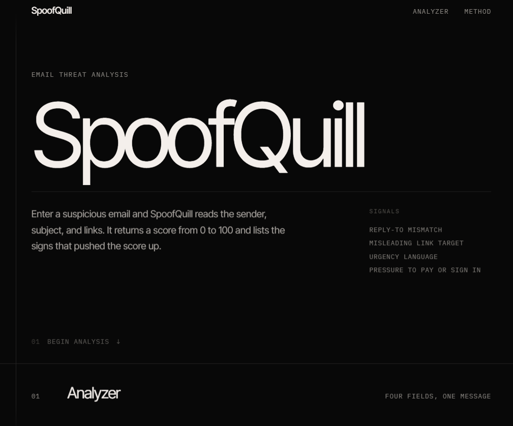

# SpoofQuill

[](https://github.com/SuryaG12/SpoofQuill/actions/workflows/ci.yml)

SpoofQuill reads an email and scores how much it looks like phishing.

**Live demo:** https://spoofquill.suryageethan1.workers.dev



## What it does

Enter the sender, reply-to, subject, and message, or load one of the examples. SpoofQuill checks the fields, then returns a score from 0 to 100, the reasons behind that score, and the sender facts it could pull from the message.

The From field is required and must be a valid email address. Reply-To is optional but must be valid when filled. Subject needs at least 3 characters, and Message needs at least 20. Inline errors appear before any request is sent.

Four signals add points:

- The reply-to address does not match the sender.
- Link text hides where the link goes.
- The message uses urgent language.
- A link asks for payment or a login.

When several signals appear in one message, a stacking bonus adds more points. Unrelated signs together are stronger evidence than any one alone.

## Project structure

- `backend/` holds the FastAPI server, the email parser, and the scoring rules.
- `frontend/` holds the page: the four fields, examples, score, and findings.
- `examples/` holds made-up phishing emails for testing.

## Run it

```bash
pip install -r requirements-local.txt
uvicorn backend.app:app --reload
```

Open http://127.0.0.1:8000/ in a browser.

## Test

```bash
pip install -r requirements-dev.txt
python -m pytest -q
```

The suite covers the example scores, structured parsing, validation, raw email compatibility, and the copies served from `public/`. CI runs the same tests on every push.

## Run on Cloudflare Workers

This project runs the same FastAPI app on Cloudflare Python Workers. The page and examples are served from Workers Static Assets, and `/analyze` and `/health` run through FastAPI.

```bash
uv sync
uv run pywrangler dev
```

Open http://127.0.0.1:8787/ in a browser.

`pywrangler deploy` publishes the Worker. No Cloudflare account is needed for local development.

## API

`POST /analyze` returns the score, the reasons, the sender, the sender domain, the reply-to address, and the links.

Send either a full raw email:

```json
{ "raw_email": "From: a@b.example\nSubject: hi\n\nHello" }
```

Or the separate fields:

```json
{
  "sender": "a@b.example",
  "reply_to": "help@b.example",
  "subject": "Account notice",
  "body": "The message body, plain text or HTML."
}
```

`raw_email` wins when both forms are present. Structured input is validated on the server as well as in the browser, and an invalid field returns HTTP 422 before scoring.

## Contributing

See [CONTRIBUTING.md](CONTRIBUTING.md) for setup, style, and pull request rules. Report vulnerabilities privately as described in [SECURITY.md](SECURITY.md).

## License

MIT. See [LICENSE](LICENSE).
